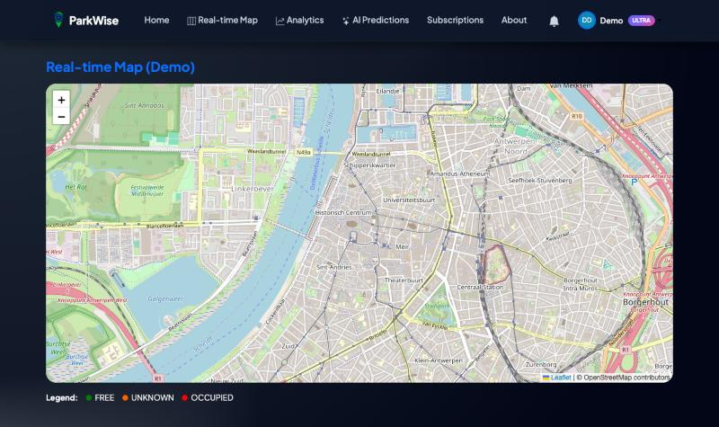
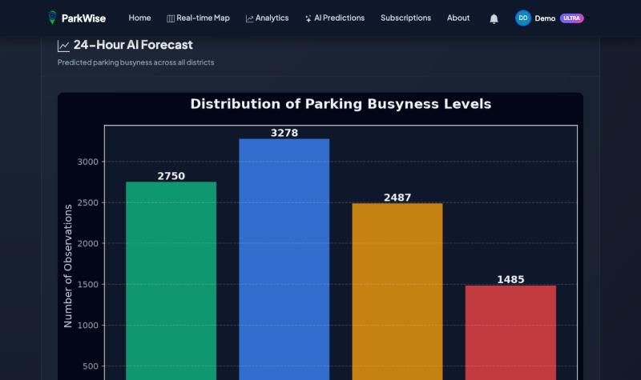
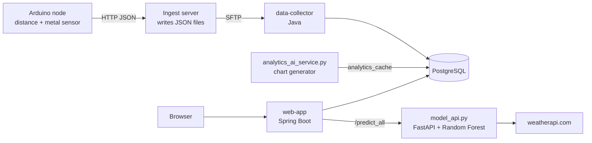

# ParkWise: IoT smart parking system

An end-to-end smart parking system: an Arduino sensor node detects whether a parking spot is occupied, a collector loads the readings into PostgreSQL, Python services produce analytics charts and machine-learning predictions, and a Spring Boot web app shows it all on a live map.



## Features

- **Sensor node (Arduino UNO R4 WiFi):** combines a VL53L0X time-of-flight distance sensor with an inductive metal sensor. A spot counts as occupied only when something is close *and* metal is detected. The node sends JSON readings over WiFi.
- **Data collection:** a Java job fetches new readings over SFTP every 5 seconds and stores them in PostgreSQL.
- **Real-time map:** Leaflet/OpenStreetMap map of Antwerp with each spot shown as free, occupied or unknown, based on its latest sensor reading.
- **Analytics:** a Python script generates charts (occupancy over time, hour/day heatmap, per-district busyness, weather impact). It stores them in the database, and the web app displays them.
- **Busyness prediction:** a Random Forest classifier (scikit-learn) trained on parking data per district, time and weather. A FastAPI service combines it with live weather to predict busyness for each Antwerp district.
- **Accounts and subscriptions:** sign up and log in (BCrypt-hashed passwords). Basic, Premium and Ultra plans unlock the map, analytics and predictions.
- **Monitoring:** detects sensors that stopped reporting, raises alerts and notifications, and has an admin page for sensor status and system logs.
- **Tests:** Cucumber (BDD) scenarios for spot availability and JUnit tests for domain value objects.



## Tech stack

| Part | Technologies |
|---|---|
| `arduino-node/` | C++, Arduino framework, PlatformIO, VL53L0X, WiFiS3 |
| `data-collector/` | Java 17, JDBC, JSch (SFTP), Maven |
| `analytics-ml/` | Python, pandas, scikit-learn, Matplotlib/Seaborn, FastAPI, Jupyter |
| `web-app/` | Java 17, Spring Boot 3.5, Spring Data JPA, Spring Security, Thymeleaf, Bootstrap, Leaflet, Cucumber, Gradle |
| Database | PostgreSQL (Docker Compose for local use) |

## Architecture



The Arduino posts each reading to an ingest endpoint on the project server, which saved it as a JSON file. That small receiver ran on the university server and is not part of this repository. The data collector picks up the newest files over SFTP. The web app reads spots, sensors and readings through JPA, reads the pre-generated charts from `analytics_cache`, and calls the prediction API over HTTP.

## Getting started

Prerequisites: Docker, JDK 17+ (Gradle downloads JDK 17 automatically if needed), Maven, and Python 3.12+. PlatformIO is only needed for the Arduino.

```bash
git clone https://github.com/miqqayell/parkwise-smart-parking.git
cd parkwise-smart-parking
docker compose up -d                      # PostgreSQL with db/schema.sql loaded
```

**Web app** (http://localhost:8080):

```bash
cd web-app
./gradlew bootRun
./gradlew test                            # needs the database running
```

**Analytics and prediction API:**

```bash
cd analytics-ml
python3 -m venv .venv && source .venv/bin/activate
pip install -r requirements.txt
python analytics_ai_service.py            # generate charts into the database
WEATHER_API_KEY=... uvicorn model_api:app --port 8000
```

**Data collector** (needs an SFTP server with `sensor_data_*.json` files):

```bash
cd data-collector
mvn compile exec:java                                   # the collector
mvn compile exec:java -Dexec.mainClass=DatabaseConnection   # connection check
```

**Arduino:** set your WiFi and server in `arduino-node/include/config.h`, then run `pio run -t upload` (see [arduino-node/README.md](arduino-node/README.md)).

All settings are read from environment variables. The defaults match `docker-compose.yml`, and `.env.example` lists them all: `DB_URL`, `DB_HOST`, `DB_USER`, `DB_PASSWORD`, `SFTP_*`, `SPOT_ID`, `WEATHER_API_KEY` and `AI_MODEL_URL`.

## My role

Full-stack web developer in a team of six. I built the front-end of the web application, integrated the third-party APIs, and built the interactive real-time map.

## What I learned

- **Java and Spring Boot:** MVC controllers, services, JPA entities and Thymeleaf views in a larger team codebase.
- **SQL and PostgreSQL:** working with a shared relational schema that several services read and write.
- **Front-end and APIs:** building responsive pages with Bootstrap and JavaScript, and integrating Leaflet maps and external APIs.
- **IoT and data:** how sensor data flows from hardware to a database, and how a trained ML model is served behind an API.
- **Teamwork:** splitting a system into components across six people and integrating them.

## Team

| Member | Role |
|---|---|
| Mikayel Ghalumyan | Full-stack web developer: front-end, API integration, interactive map |
| Teammate 1 | Arduino and sensors |
| Teammate 2 | Team lead, database design and back-end |
| Teammate 3 | Back-end and DevOps: sensor monitoring, admin dashboard, authentication |
| Teammate 4 | Web UI and data analysis |
| Teammate 5 | Linux server and deployment |

## Context

University project, KdG Applied Computer Science, Integration 3, 2025-2026.

When preparing this repository I combined the four original repositories into one, moved all credentials to environment variables, added Docker Compose, a Maven build for the collector and `requirements.txt`. I also fixed the build, test discovery (the Cucumber scenarios were not running) and two bugs: a broken upgrade page and a feature-name mismatch in the prediction API. The commit history shows each change.

## Possible improvements

- The collector re-reads the latest five files on every run, so it inserts duplicate readings. It should remember which files it has processed.
- Replace the SFTP/file hand-off with the Arduino posting directly to the web app's REST API.
- The home page shows placeholder marketing numbers (sensor count, accuracy) that were not measured. They should be replaced with live values or removed.
- Move the remaining hard-coded parking locations and thresholds into configuration, and add tests for the prediction and analytics services.
